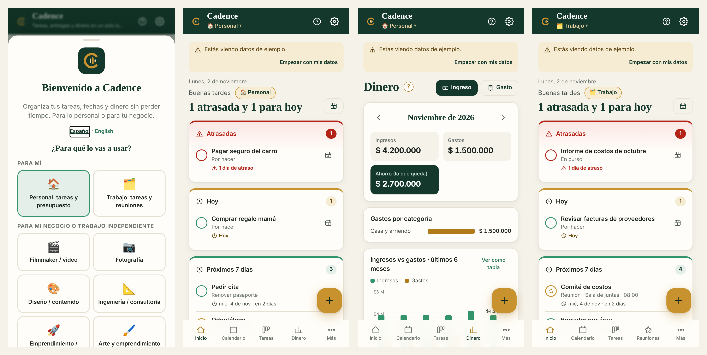
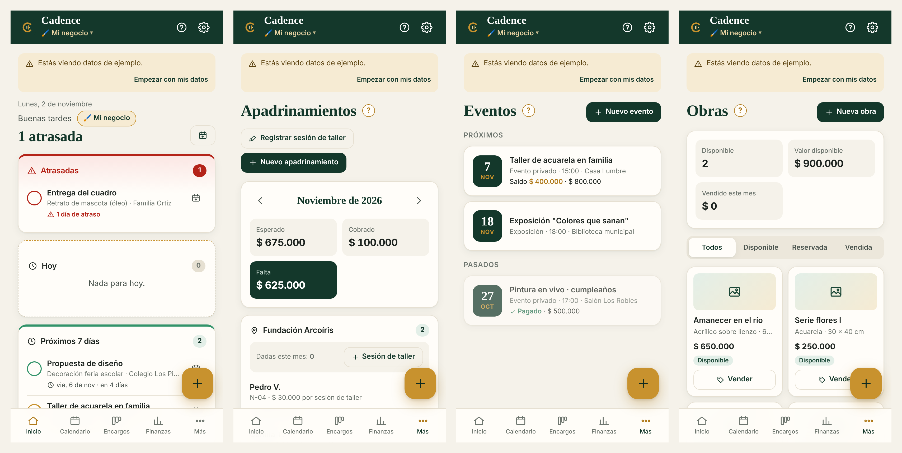
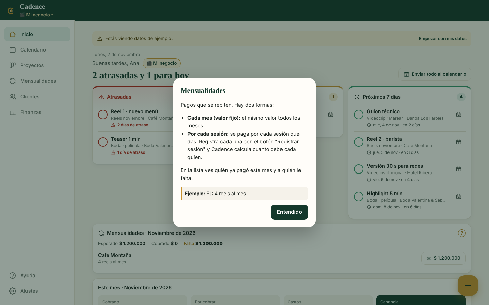
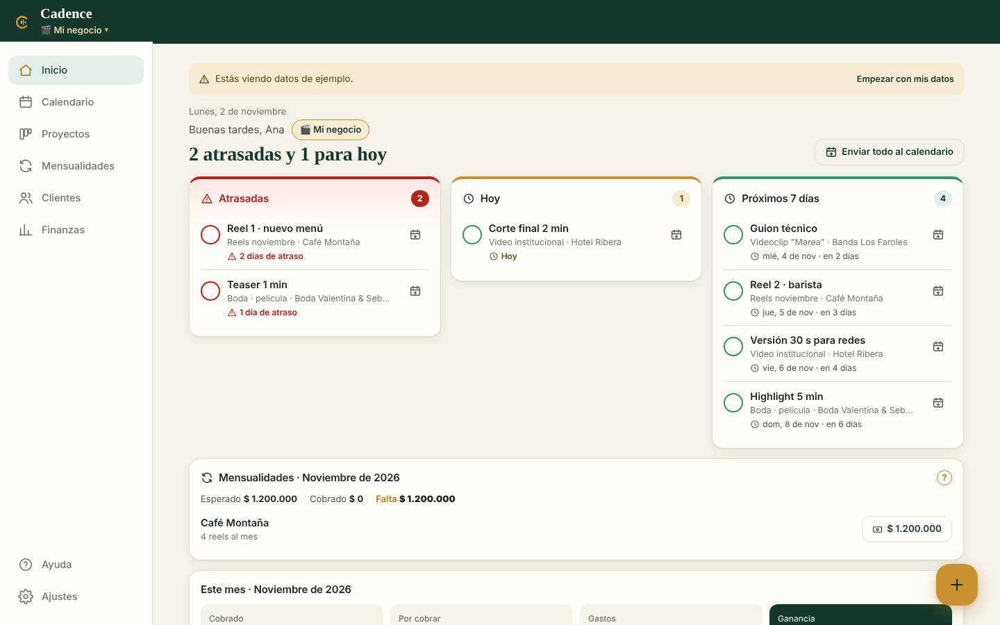

# Cadence · Proyectos, entregas y dinero para el trabajo independiente

**[Read in English](README.md)** · **[Abrir la app](https://melarpe.github.io/cadence/)**

> © 2026 Melarpe · Melissa Aristizabal. **No es código abierto:** el código está publicado para que se pueda revisar como parte de mi portafolio. Todos los derechos reservados (ver [LICENSE](LICENSE)).

Cadence es una aplicación web instalable (PWA) para organizar **tareas, fechas, citas y dinero** desde el celular, en segundos. Sirve para la vida personal, para el trabajo y para un negocio o trabajo independiente. Cada persona puede tener cada cosa en su propio **espacio** y cambiar con un toque.

Está pensada para tres tipos de usuario:

- **Un filmmaker independiente** con muchos clientes y entregas casi todas las semanas, que necesita no olvidar ninguna entrega y ver claro cuánto gana, gasta y le deben.
- **Un pequeño emprendimiento social de arte** que enseña arte a niños en fundaciones (pagado por padrinos, por taller), hace eventos privados, vende cuadros y acepta encargos. Está empezando y su dinero viene de cinco lugares distintos.

- **Una persona con empleo de oficina** que necesita sus tareas, informes y reuniones en un solo lugar, y el presupuesto de la casa. Sin clientes ni cobros.

Por eso Cadence es general pero directa: cada espacio tiene una **plantilla** que cambia las palabras, las etapas, las categorías y las secciones, y lo que no se usa no aparece.

## Qué resuelve

| Problema | Qué hace Cadence |
|---|---|
| Entregas olvidadas | El inicio muestra **Atrasadas / Hoy / Próximos 7 días**. Entregas y eventos se envían a **Google Calendar** o al calendario del celular o computador (iPhone, Mac, Outlook), según lo que elija cada persona. |
| Dinero de muchas fuentes | Cada ingreso tiene un **tipo** (proyecto, evento, venta, ingreso fijo, otro). Finanzas muestra ingresos por tipo, gastos por categoría, ganancia y gráfico de 6 meses. |
| Padrinos que pagan por taller, clientes con mensualidad | **Ingresos fijos** de dos formas: cada mes o por sesión. Registras cada taller una vez y Cadence calcula cuánto debe cada padrino de ese grupo; la lista muestra quién pagó y quién falta. |
| Obras y productos para vender | **Inventario** con precio y estado. "Vender" registra el ingreso solo. |
| Talleres y eventos | **Eventos** con fecha, hora, lugar, valor y pagos. |
| Personas no técnicas | Botón **?** con explicación simple y ejemplo, guías paso a paso dentro de la app y pantallas vacías que dicen qué hacer primero. |
| Lo personal mezclado con el negocio | **Espacios**: una sola cuenta con cuadernos separados (Personal, Trabajo, Mi negocio…). Cada persona agrega solo los que necesita. |
| Mismos datos en el celular y el computador | **Cuentas opcionales con Firebase**. Cada persona entra con su cuenta y solo ve sus datos; todos sus espacios se sincronizan. |

## Funciones

- **Inicio:** saludo con tu nombre, el espacio actual y un resumen ("1 atrasada y 1 para hoy"); atrasadas, hoy y próximos 7 días; meta del mes.
- **Calendario**, **proyectos por etapas** (Kanban), **clientes**, **finanzas** con gráfico de 6 meses y exportación a Excel (CSV).
- **Ingresos fijos, eventos e inventario** opcionales, según la plantilla.
- **Plantillas "para mí":** Personal y Trabajo. **"Para mi negocio":** filmmaker, fotografía, diseño, ingeniería, emprendimiento, arte y emprendimiento social, independiente.
- **Calendario a elección:** Google Calendar o el calendario del celular o computador.
- **Funciona en iPhone, Android, Windows y Mac**, se instala sin tienda de apps y abre sin internet.
- **Español e inglés**, moneda configurable, política de privacidad dentro de la app.

## Decisiones técnicas

| Decisión | Por qué |
|---|---|
| HTML, CSS y JavaScript puros, sin compilación | Corre en cualquier navegador, se publica gratis en GitHub Pages y es fácil de revisar. |
| PWA | Se instala en iPhone, Android, Windows y Mac sin tienda de apps y abre sin internet. En Chrome y Edge hay botón de instalar de un toque. |
| Primero local (`localStorage`), después la nube | La app responde al instante y funciona sin cuenta. |
| Firebase (Auth + Firestore, plan gratis) en vez de Google Sheets | Sin configuración por persona, más rápido, en tiempo real, varias personas con datos separados. |
| Un documento por registro (`users/{uid}/spaces/{espacio}/...`) | Escrituras pequeñas, dos dispositivos pueden editar a la vez, sin límite de 1 MB por documento. |
| Espacios guardados por separado | Cambiar de espacio es instantáneo y sin internet; solo el espacio en pantalla escucha cambios en tiempo real, lo que ahorra lecturas del plan gratis. |
| Plantillas con secciones y palabras propias | Un solo código sirve a un filmmaker, a un emprendimiento de arte y a una persona con empleo de oficina; nadie ve lo que no usa. |
| Detección de cambios por "huella", gana la edición más reciente, borrados con marca | Los borrados también llegan al otro dispositivo. |
| SDK de Firebase incluido en el repositorio (`js/vendor`) | No depende de un CDN y solo se carga si hay cuentas configuradas. |
| Calendario: enlaces de Google Calendar o archivos `.ics`, a elección | Las notificaciones web en iOS necesitan servidor. Google Calendar en Android no abre `.ics`, por eso cada persona elige. |
| Historial del navegador para cada pantalla y formulario | El botón atrás de Android cierra primero el formulario abierto y después vuelve a la pantalla anterior. |
| Gráfico SVG propio con colores validados para daltonismo | Sin librerías; los estados siempre llevan ícono y texto, no solo color. |
| Datos mínimos de niños | Solo nombre o código; el formulario lo recuerda. |

## Cómo se probó

- Con Playwright en tamaño iPhone 17 Pro, Android pequeño, Mac y portátiles Windows, en español e inglés: navegación, formularios, espacios, botón atrás de Android, instalación, calendario, privacidad y errores de consola.
- Sincronización probada de punta a punta con dos dispositivos simulados.

## Licencia

Todos los derechos reservados © 2026 Melarpe · Melissa Aristizabal. El código es público solo para que se pueda revisar; no se puede copiar, modificar, distribuir, publicar ni usar con fines comerciales sin permiso por escrito. Ver [LICENSE](LICENSE). Los datos de ejemplo son ficticios.

---
Hecho por **Melissa Aristizabal** · Ingeniera de Energía (UNILA) · Maestría en Ingeniería Mecánica, UFRGS · [GitHub](https://github.com/melimape) · Una app de **Melarpe**
