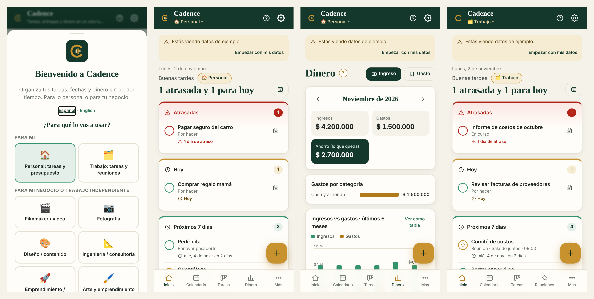
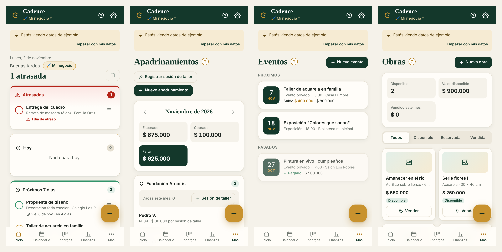
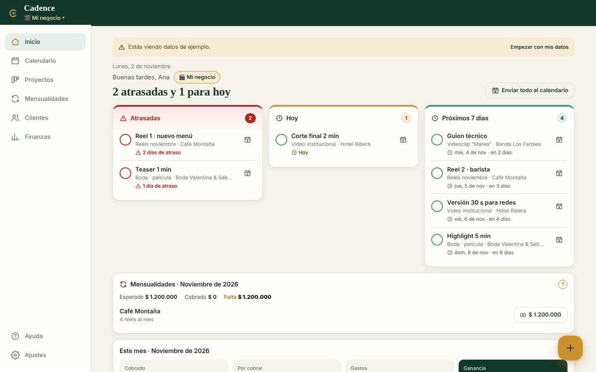
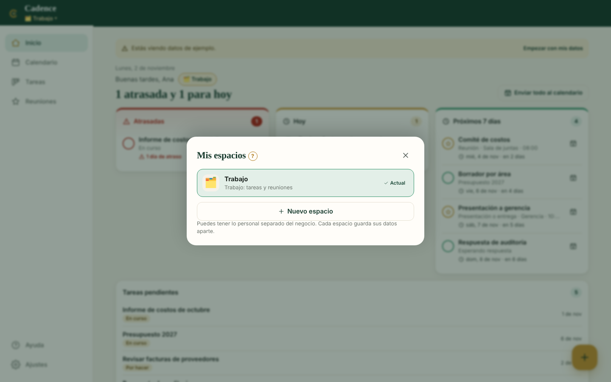
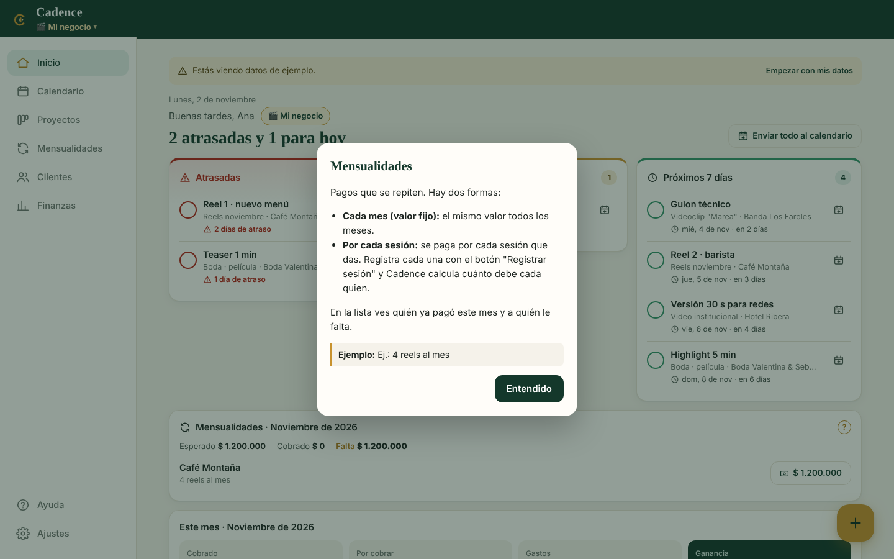
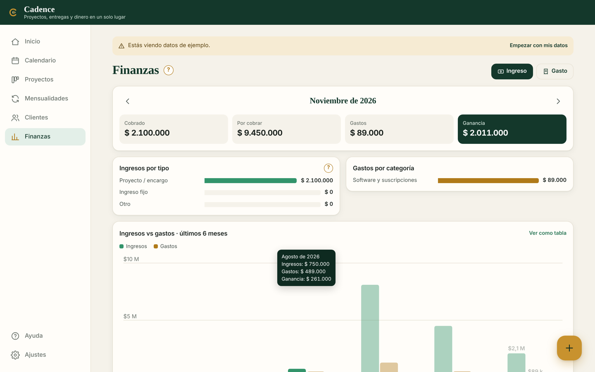

# Cadence · Projects, deliveries & money for independent work

**[Leer en español](README.es.md)** · **[Live demo](https://melimape.github.io/cadence/)**

Cadence is an installable web app (PWA) to keep **tasks, deadlines, appointments and money** organized from the phone, in seconds. It works for personal life, for a job, and for a small business or freelance work. One person can keep each of these in its own **space** and switch with one tap.

It is designed around three typical users:

- **A freelance filmmaker** with many clients and deliveries almost every week, who needs to never miss a deadline and see clearly what is earned, spent and still owed.
- **A small social art venture** that teaches art to children in foundations (paid by sponsors, per workshop), runs private events, sells paintings and takes commissions. Just starting, with income coming from five different places.
- **An office employee** who needs tasks, reports and meetings in one place, plus a home budget. No clients, no invoices.

So Cadence is general but direct: a **template** per space switches the wording, stages, categories and sections, and anything you do not need stays hidden.




## Problem → solution

| Problem | What Cadence does |
|---|---|
| Forgotten deliveries | Home opens on **Overdue / Today / Next 7 days**. Deliveries and events go to **Google Calendar** (prefilled links) or to the phone/computer calendar (`.ics` with reminders), whichever each person picks. |
| Money scattered across many sources | Every income has a **type** (project, event, sale, recurring, other). Finance shows income by type, expenses by category, profit and a 6-month chart. |
| Sponsors paying per workshop, clients paying monthly | **Recurring income** with two modes: fixed monthly, or per session. Log each workshop once and Cadence works out what each sponsor in that group owes; the list shows who paid and who did not. |
| Artworks and products for sale | **Inventory** with price and status (available, reserved, sold). "Sell" logs the income automatically. |
| Workshops and private events | **Events** with date, time, place, fee and payments. |
| Admin takes too long | One **+** button for everything. A project with client, deposit and first delivery is one form. |
| Non-technical users | A **?** button next to every non-obvious field with a plain explanation and an example, step-by-step guides inside the app, and empty screens that say what to do first. |
| Personal life and business mixed together | **Spaces**: one account, several separate notebooks (e.g. Personal, Work, My business). Each has its own template and data; people add only the spaces they need. |
| Same data on phone and computer | Optional **accounts with Firebase**. Each person signs in and only sees their own data, all spaces synced. |

## Features

- **Home:** delivery and event alerts, recurring payments missing this month, monthly KPIs and goal, active projects. First-time users get a 3-step checklist.
- **Calendar:** month view of deliveries, events and workshop sessions, with a color + label legend.
- **Projects (Kanban):** drag and drop on desktop, arrow buttons on touch screens; auto-moves to the final stage when every deliverable is done.
- **Recurring income · Events · Inventory:** optional modules, turned on by template or in Settings.
- **Clients:** contact card with WhatsApp link, history, total billed and balance.
- **Finance:** income by type, expenses by category, 6-month income vs expenses chart (tooltips + table view), what you are owed, CSV export for Excel.
- **Spaces:** create, rename, switch and delete; the first screen asks "what will you use it for?" and creates just one.
- **Templates "for me":** *Personal* (tasks, appointments, income, expenses, savings goal) and *Job* (tasks, meetings, "waiting on others" stage, no money).
- **Templates "for my business":** filmmaker, photography, design/content, engineering/consulting, small business, art & social enterprise, independent (any trade).
- **Sections on demand:** events, money, recurring income and inventory can be switched on or off per space.
- **Spanish / English**, configurable currency (COP default), offline-first, installable on iPhone, Android, Windows and Mac (one-tap install button on Chrome and Edge).






## Tech decisions

| Decision | Why |
|---|---|
| Vanilla HTML, CSS, JS. No build step | Runs anywhere, free hosting on GitHub Pages, easy to read and review. |
| PWA (manifest + service worker) | Feels like an app on iPhone, Android, Windows and Mac without an app store; opens offline. Captures `beforeinstallprompt` for a one-tap install. |
| Local-first: `localStorage` is the source the UI reads | Instant on a slow connection; works with no account at all. |
| Firebase Auth + Firestore (free Spark plan) for sync | Free with no card, real-time between devices, per-user security rules. Replaced a Google Sheets backend from v1: no per-user setup, faster, multi-user. |
| One Firestore document per item (`users/{uid}/spaces/{spaceId}/{collection}/{id}`) | Small writes, two devices can edit different things at once, no 1 MB document limit. |
| Spaces as separate local stores + a small index | Switching is instant and offline; only the space on screen keeps real-time listeners, which saves free-tier reads. |
| Modules + wording per template instead of separate apps | One codebase serves a filmmaker, an art venture and an office employee; nothing they do not use is shown. |
| Change detection by fingerprint, last-write-wins by `updatedAt`, tombstones for deletes | The UI code never has to remember to "mark dirty"; deletes propagate across devices. |
| Firebase SDK bundled locally (`js/vendor`, built with esbuild) | No CDN dependency, cached by the service worker, loaded only when accounts are configured. |
| Calendar: Google Calendar links or `.ics`, chosen per device | iOS web push needs a server; Google Calendar on Android cannot open `.ics`, so each person picks. |
| Every screen and open sheet is a history entry | The Android back button closes the open form first, then returns to the previous screen. |
| Privacy policy in the app + recorded consent | Written for Colombia's data law (Ley 1581/2012); sign-up requires accepting it and stores date + version in the user's own folder. |
| Hand-built SVG chart, palette validated for color-vision deficiency | No chart library; values in tooltip and table view; status always uses icon + label, never color alone. |
| Minimal data about children | Sponsored children are stored as a first name or code only; the form reminds the user. |

## Data model

```
index      current, lang, list[{ id, name, template, deleted, updatedAt }]   ← one per person
-- per space --
settings   name, currency, template, stages[], categories[], eventTypes[], monthlyGoal,
           modules{ clients, finance: business|personal|false, events, recurring, inventory }
clients    id, name, contact, phone, email, notes
projects   id, title, clientId, stage, total, deliverables[{id,title,date,done}], notes
incomes    id, date, amount, type(project|salary|event|sale|recurring|other), refId, note
expenses   id, date, amount, category, description, projectId
events     id, title, type, date, time, place, clientId, total, done, notes
inventory  id, title, technique, size, price, status(available|reserved|sold), notes
recurring  id, payer, concept, group, amount, frequency(monthly|per_session), startDate, active, notes
sessions   id, date, group, note
```

**Recurring logic.** For a month *m*: monthly → `due = amount`; per session → `due = amount × sessions in m for that group`. `paid` = recurring incomes for that agreement in *m*. Status: paid / partly paid / missing.

## Project structure

```
cadence/
├── index.html              app shell
├── manifest.webmanifest    install info
├── sw.js                   service worker (offline)
├── firestore.rules         security rules: each user reads/writes only users/{their uid}
├── css/styles.css          design system (deep green + burnt gold)
├── js/
│   ├── i18n.js             all text ES/EN, help texts and in-app guides
│   ├── templates.js        work templates + fictional sample data
│   ├── firebase-config.js  admin settings: Firebase values (empty = local only) + privacy contact
│   ├── store.js            spaces, data model, localStorage, v1/v2 → v3 migration
│   ├── cloud.js            Firebase auth + sync of every space
│   ├── app.js              views, forms, chart, CSV and calendar export
│   └── vendor/firebase-13.1.0.js   bundled Firebase SDK
├── icons/                  app icons
└── docs/                   screenshots
```

## Run locally

```bash
git clone https://github.com/melimape/cadence.git
cd cadence
python3 -m http.server 8000      # open http://localhost:8000
```

## Firebase setup (optional, ~10 minutes)

1. [console.firebase.google.com](https://console.firebase.google.com) → **Add project** (Spark plan, no card).
2. **Add app → Web**. Copy the `firebaseConfig` values into `js/firebase-config.js`.
3. **Authentication → Sign-in method:** enable *Email/Password* and *Google*.
4. **Authentication → Settings → Authorized domains:** add `melimape.github.io`.
5. **Firestore Database → Create database** (production mode).
6. **Firestore → Rules:** paste [`firestore.rules`](firestore.rules) and publish.
7. Push, and bump `VERSION` in `sw.js` so installed apps update.

End users never see setup steps: without Firebase, Settings only says their data is saved on this device, and the account guide in Help appears only once accounts are configured.

The config values are public by design; the rules are what protect the data. The detailed Spanish guide with every click is in [README.es.md](README.es.md#3-configurar-firebase-cuentas-y-sincronización).

## How it was tested

- Playwright at iPhone 17 Pro (402×874), small Android (360×780), Mac (1440×900) and Windows laptop sizes (1366×768, 1536×864 at 125%), Spanish and English, five templates: navigation, every form, spaces (create, switch, rename, delete, reload), turning sections on and off, CSV and `.ics` downloads, console errors, migration of v2 data.
- Sync tested end to end with two browser contexts (an iPhone and a Mac) against an in-memory stand-in for the Firebase SDK: two local spaces upload on first sign-in, the second device receives both, edits, new spaces and deleted spaces travel both ways, reload keeps state, sign-out clears the device, a second person on the same device sees nothing from the first.

## Roadmap

- Quote / invoice PDF per project
- Looker Studio template on top of the CSV exports
- Recurring reminders by email (Cloud Functions, needs the paid plan)

## License

All rights reserved © 2026 Melissa Aristizabal. The source is public so it can be reviewed; it may not be copied, modified, redistributed or used commercially without written permission. See [LICENSE](LICENSE). Sample data is fictional.

---
Built by **Melissa Aristizabal** · Energy Engineer (UNILA) · M.Sc. student in Mechanical Engineering, UFRGS · [GitHub](https://github.com/melimape)
